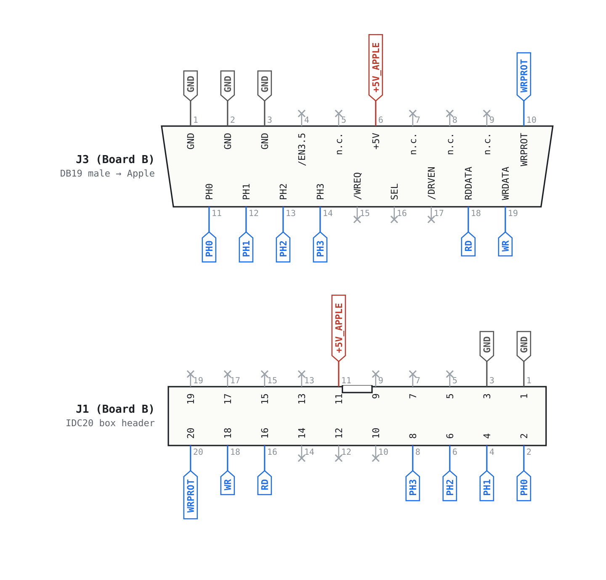
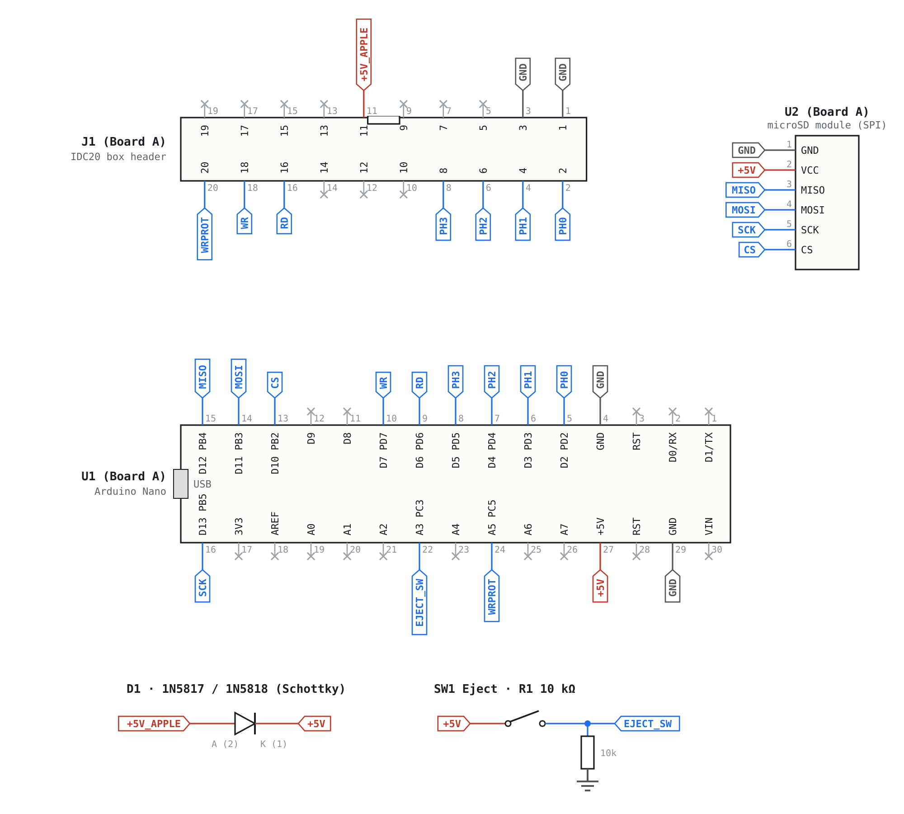
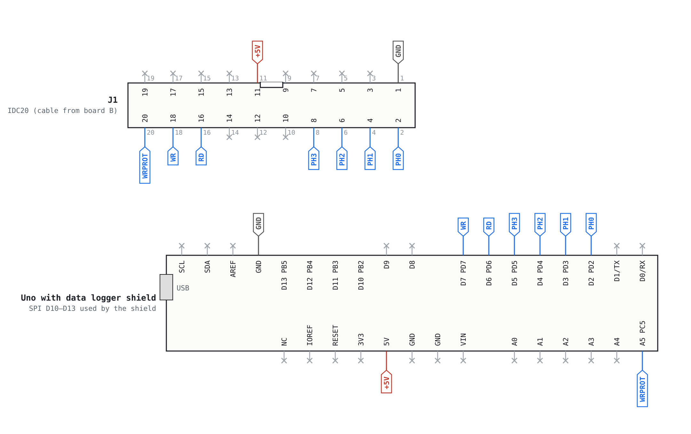
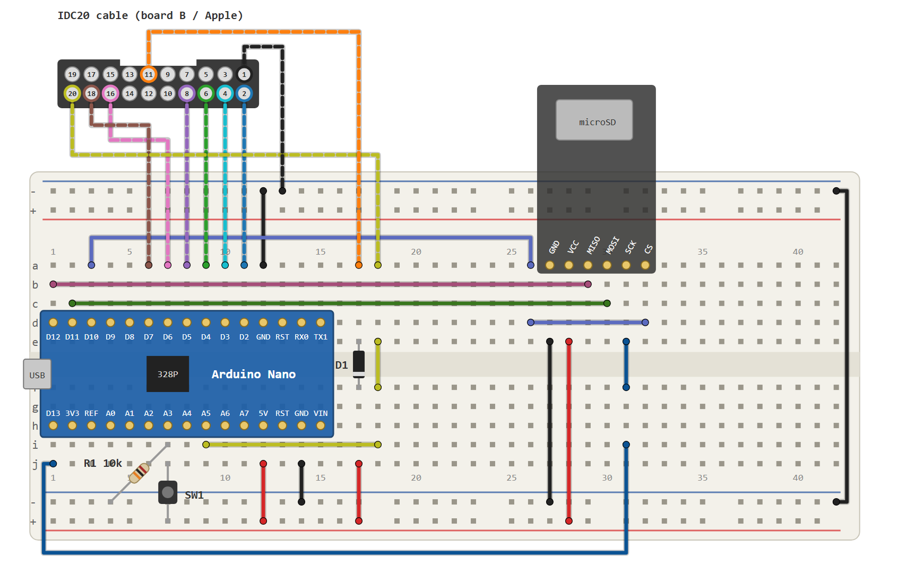
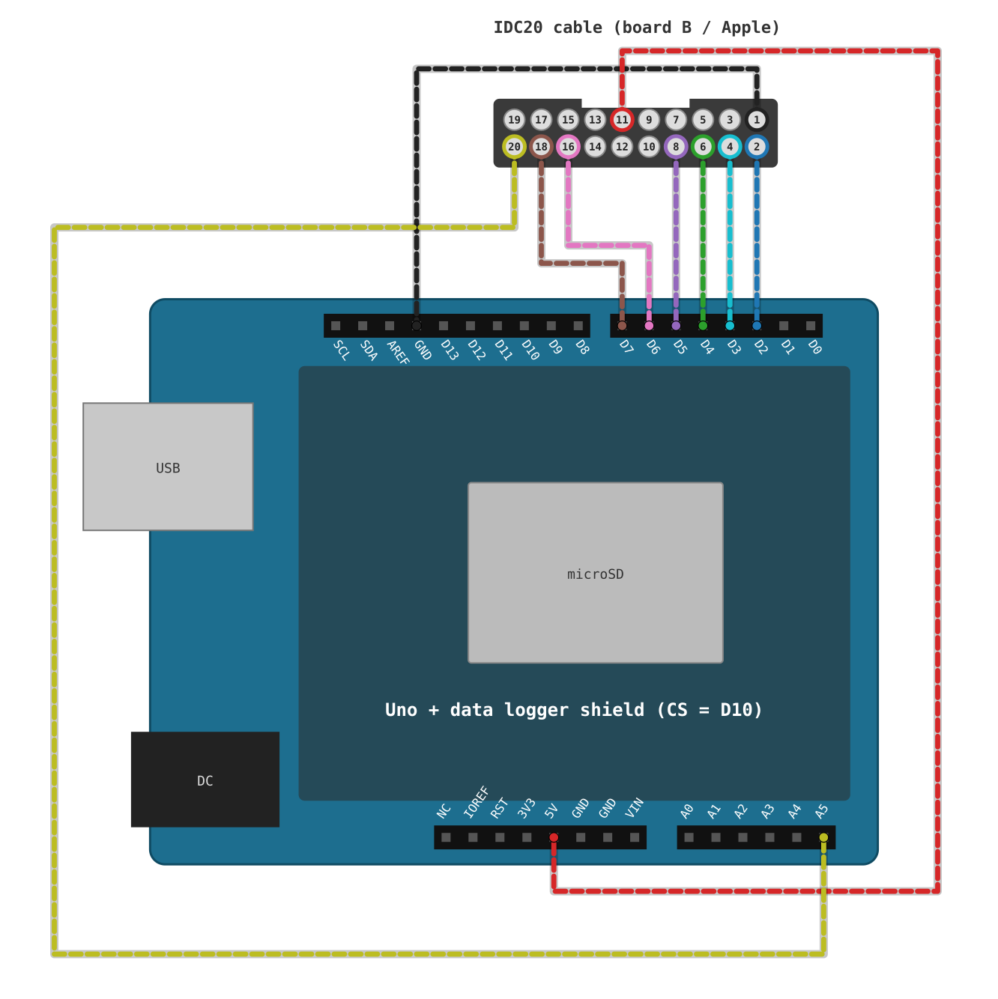

# SmartportSD – Schematic & Breadboard

Based on Robert Justice's SmartportCFA design (Arduino port by Andrea Ottaviani). Boards A and B follow the SPIISD V1 by Kay Koba (Kero's Mac Mods).

**Ready-made board:** instead of building the circuit on a breadboard with a Nano or Uno, you can use Kay Koba's ready-made PCB from the [SP2SD DIY kit](https://github.com/kerokero5150/SP2SD_DIY_KIT). [QUICK.md](../QUICK.md) takes you from assembling it to a booting Apple.

The drawings are available as PNG (for viewing) and SVG (for editing) in the `img` folder.

## Connecting to the Apple

There are two ways to connect the Nano or Uno to the Apple's DB19 disk port:

- **Via board B:** the DB19 plug sits on board B, and a 20-pin ribbon cable (IDC20) carries the signals to board A or to the Uno. This is the wiring shown in the drawings.
- **Directly:** a DB19 plug is wired straight to the Nano or Uno pins with single wires, as in Andrea Ottaviani's and Robert Justice's original builds. Board B and the IDC20 are not needed then.

Direct wiring, DB19 → Nano / Uno:

| DB19 | Signal | Nano / Uno |
|---|---|---|
| 1 (2, 3 optional) | GND | GND |
| 6 | +5V | 5V (on the Nano build through D1) |
| 10 | WRPROT / ACK | A5 |
| 11 | PH0 / REQ | D2 |
| 12 | PH1 | D3 |
| 13 | PH2 | D4 |
| 14 | PH3 | D5 |
| 18 | RDDATA | D6 |
| 19 | WRDATA | D7 |

All other DB19 pins stay unconnected. Do not connect pins 5, 7 and 8 (−12 V / +12 V).

## Board B – DB19 adapter

## Board A – main board with Nano

Boards A and B are connected 1:1 by a 20-pin ribbon cable (or a 2×10 pin header).

## Variant – Arduino Uno with data logger shield

This is the setup Robert Justice tested: an Uno with a data logger shield (SD card slot and RTC), wired straight to the DB19. Same nets as board A, but without D1 and without the eject button (SW1/R1): the Apple's 5 V goes directly to the Uno's 5V pin. The shield must use D10 as chip select (shields with CS on D4 collide with PH2). The cable comes from board B (IDC20).

If a particular shield does not work: its RTC sits on I²C, and on the Uno SDA/SCL are connected to A4/A5. A5 is WRPROT/ACK, so the RTC and its I²C pull-up resistors load that line. Removing the pull-ups (or cutting SCL to the RTC) is the first thing to try.

## Signal mapping

| Signal | DB19 | IDC20 | Nano | Uno | AVR | Firmware role |
|---|---|---|---|---|---|---|
| PH0 | 11 | 2 | D2 | D2 | PD2 | REQ (input) |
| PH1 | 12 | 4 | D3 | D3 | PD3 | Phase (input) |
| PH2 | 13 | 6 | D4 | D4 | PD4 | Phase (input) |
| PH3 | 14 | 8 | D5 | D5 | PD5 | Phase (input) |
| RDDATA | 18 | 16 | D6 | D6 | PD6 | Data to the Apple (output, otherwise tri-state) |
| WRDATA | 19 | 18 | D7 | D7 | PD7 | Data from the Apple (input) |
| WRPROT | 10 | 20 | A5 | A5 | PC5 | ACK (output while the bus is enabled, otherwise input) |
| +5V | 6 | 11 | +5V (via D1) | 5V (direct, no D1) | – | Supply from the Apple |
| GND | 1, 2, 3 | 1, 3 | GND | GND | – | Ground |
| CS / MOSI / MISO / SCK | – | – | D10–D13 | D10–D13 (shield) | PB2–PB5 | SPI to the SD card |
| EJECT_SW | – | – | A3 | – | PC3 | Push button, active high (10k pull-down) |

## Notes

- **D1** feeds the Apple's 5 V through a Schottky diode to the Nano's 5V pin. It prevents current from flowing back into the Apple while the Nano is powered via USB.
- **The SD module** is powered from 5 V, so it needs its own 3.3 V regulator and level shifter, like the common Arduino microSD boards.

## Breadboard layout

## Breadboard layout – Arduino Uno with data logger shield

